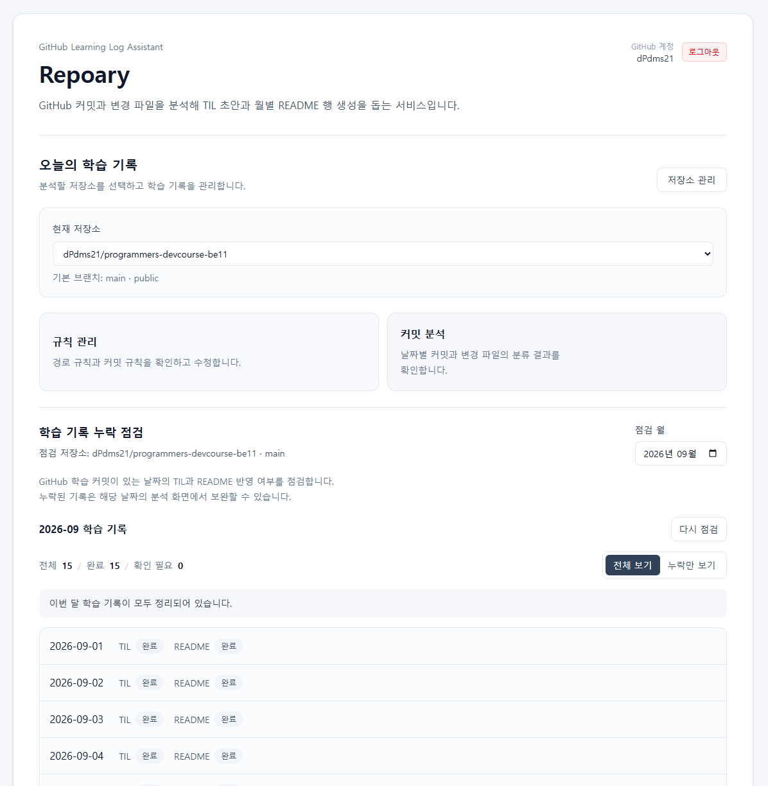
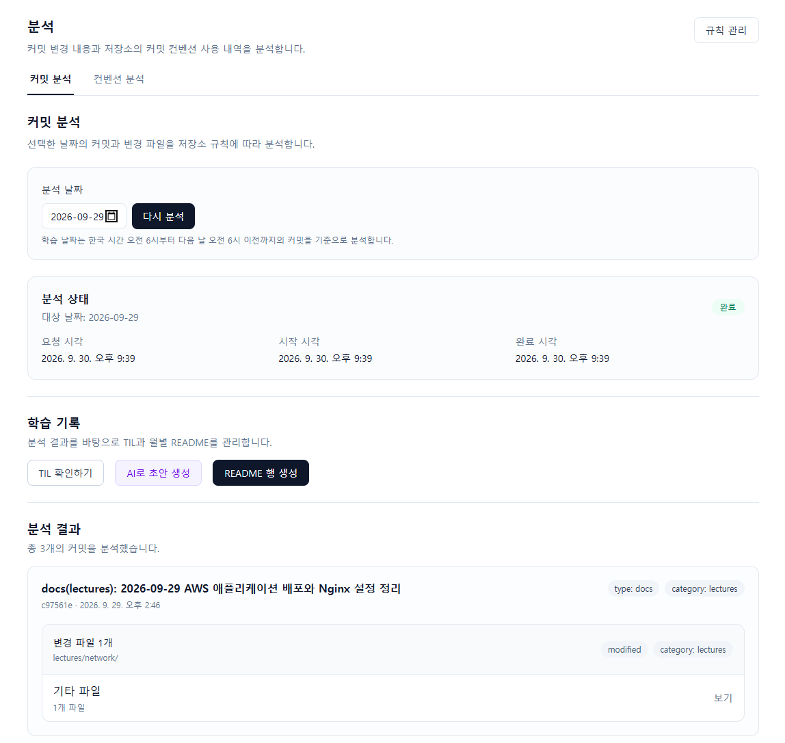
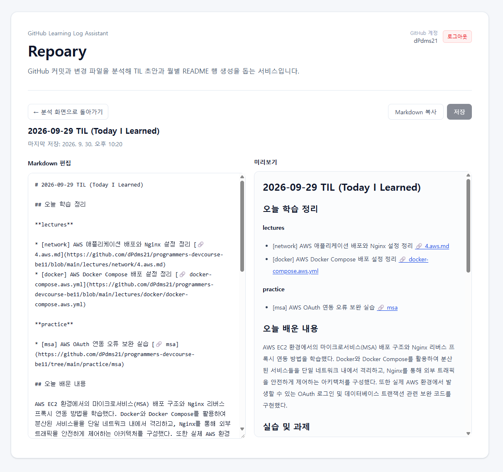
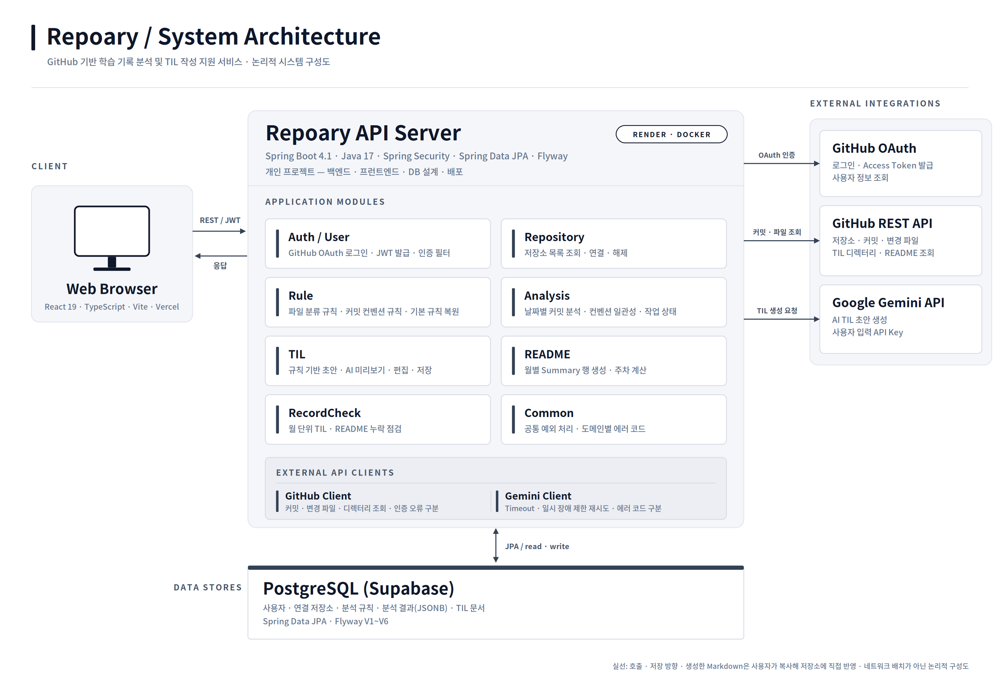
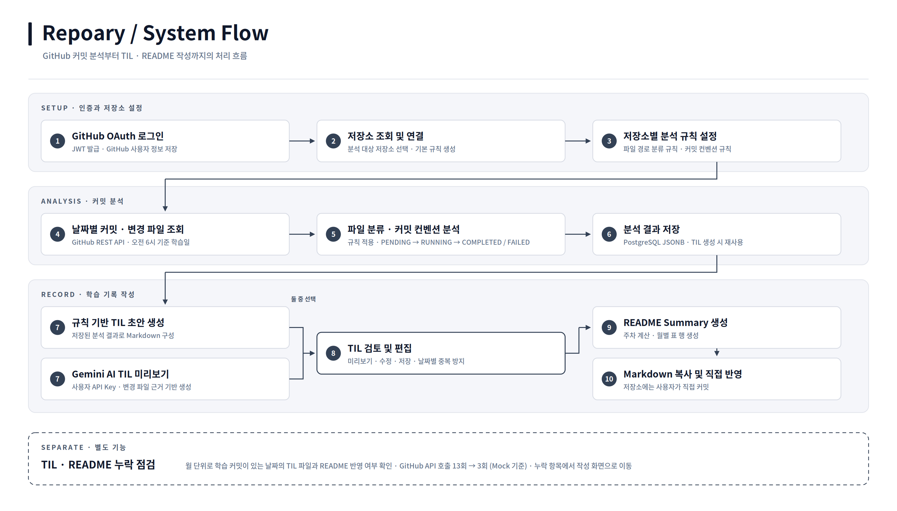

# Repoary

**GitHub 기반 학습 기록 분석 및 TIL 작성 지원 서비스**

Repoary는 GitHub 저장소의 커밋과 변경 파일을 분석하여 학습 내용을 정리하고,   
TIL(Today I Learned)과 월별 README 작성을 지원하는 웹 서비스다.

개발 과정에서 누적된 커밋 이력을 학습 기록으로 정리하는 반복 작업을 줄이고,   
저장소별 규칙에 따라 학습 내용을 분류하고 누락된 기록을 확인할 수 있도록 구현했다.

규칙 기반 TIL 생성과 Gemini를 활용한 AI 초안 생성 기능을 제공하며, 생성된 내용은 사용자가 직접 검토하고 편집할 수 있다.



## Project Overview

개발 학습 과정에서는 GitHub에 커밋을 남긴 뒤 변경 파일을 다시 확인하고,   
학습 내용을 TIL로 정리하고, 월별 README에 반영하는 작업이 반복된다.

특히 여러 작업을 하루에 수행하거나 기록이 누적되면 실제 변경 내용을 다시 파악하는 데 시간이 소요되고,   
TIL이나 README 반영이 누락될 수 있다.

Repoary는 이러한 문제를 해결하기 위해 GitHub 커밋 이력과 변경 파일을 분석하고,   
저장소별 규칙을 적용하여 학습 기록 작성과 관리 과정을 지원한다.

| 항목 | 내용 |
|---|---|
| 프로젝트 유형 | 프로그래머스 데브코스 BE11 개인 프로젝트 |
| 개발 기간 | 2026.07 ~ (진행 중) |
| 개발 인원 | 1명 |
| 담당 영역 | 백엔드·프론트엔드 개발, DB 설계, 외부 API 연동, 배포 |
| 서비스 | https://repoary-fe.vercel.app |
| GitHub | https://github.com/dPdms21/repoary |

## Key Features

| 커밋 분석 | TIL 편집 |
|---|---|
|  |  |

### 1. GitHub 인증 및 저장소 관리

- GitHub OAuth를 통한 로그인 및 JWT 발급
- GitHub 사용자 정보 조회 및 저장
- GitHub 저장소 목록 조회
- 분석 대상 저장소 연결 및 연결 해제
- 연결 저장소의 기본 브랜치와 공개 여부 확인

### 2. 저장소별 분석 규칙 관리

저장소마다 폴더 구조와 커밋 컨벤션이 다르다는 점을 고려하여   
분류 규칙과 커밋 규칙을 개별적으로 설정할 수 있도록 구현했다.

- 저장소 연결 시 기본 분석 규칙 생성
- 파일 경로 기반 학습 카테고리 분류
- 커밋 메시지의 type·scope 분석
- 분류 규칙 및 커밋 규칙 추가·조회·수정·삭제
- 규칙별 우선순위 및 활성화 상태 관리
- 기본 규칙 복원

### 3. GitHub 커밋 및 변경 파일 분석

선택한 날짜의 커밋과 변경 파일을 GitHub API로 조회하고, 저장소별 규칙을 적용하여 학습 내용을 분석한다.

- 날짜별 GitHub 커밋 조회
- 커밋별 변경 파일 및 변경 정보 조회
- 파일 경로와 커밋 메시지를 기반으로 작업 분류
- 분석 작업 상태(`PENDING → RUNNING → COMPLETED / FAILED`) 및 이력 조회
- 분석 결과를 PostgreSQL JSONB로 저장

### 4. 커밋 컨벤션 일관성 분석

특정 기간의 커밋을 작업 영역별로 분류하고, 커밋 메시지의 일관성을 분석한다.

- 기간별 커밋 조회 및 분석
- 변경 파일 경로를 통한 작업 영역 분류
- 동일 작업 영역 내 type·scope 비교
- 커밋 메시지 패턴의 일관성 점검
- 분석 결과 화면 제공

### 5. TIL Markdown 생성 및 편집

완료된 커밋 분석 결과를 바탕으로 TIL 초안을 생성하고 관리할 수 있도록 구현했다.

- 저장된 분석 결과 기반 TIL 초안 생성
- 학습 내용 및 작업 영역별 Markdown 구성
- 날짜별 TIL 조회
- TIL 내용 수정 및 저장
- Markdown 미리보기 및 클립보드 복사
- 동일 날짜 TIL 중복 생성 방지

TIL 생성 시 저장된 분석 결과를 재사용하여, 초안 생성 단계에서 커밋 분석을 다시 수행하지 않도록 구성했다.

### 6. Gemini 기반 AI TIL 생성

커밋과 변경 파일의 실제 내용을 활용하여 Gemini 기반 TIL 초안을 생성하는 기능을 구현했다.

- 사용자 입력 Gemini API Key 기반 요청
- 기존 커밋 분석 결과와 GitHub 변경 파일 정보를 AI 입력으로 구성
- 학습 내용, 실습 및 과제, 헷갈렸던 점, 추가 학습 내용 생성
- 변경 근거가 부족한 내용의 임의 생성을 제한하는 프롬프트 구성
- AI 생성 결과 미리보기
- 생성 결과를 TIL 문서에 적용 및 저장

기존 규칙 기반 TIL 생성 기능과 AI 생성 기능을 분리하여 제공한다.   
AI가 생성한 내용은 사용자가 확인한 뒤 TIL에 반영하는 방식이다.

### 7. 월별 README Summary 생성

작성된 TIL을 기반으로 월별 README에 추가할 Summary 행을 생성한다.

- 특정 날짜의 저장된 TIL 조회
- TIL 본문 기반 Summary 생성
- 월요일~일요일 기준 주차 계산
- README용 Markdown 표 행 생성
- 결과 미리보기 및 복사

생성된 README 행은 별도로 저장하지 않으며, 사용자가 복사하여 기존 README에 반영하는 방식이다.

### 8. TIL 및 README 누락 점검

GitHub의 학습 커밋을 기준으로 TIL과 월별 README의 작성 여부를 점검한다.

- 월별 학습 기록 점검
- 커밋 메시지와 날짜를 활용한 점검 대상 선정
- GitHub 저장소 내 TIL 파일 존재 여부 확인
- 월별 README에 해당 날짜 반영 여부 확인
- 날짜별 완료·누락 상태 제공
- 월별 요약 및 누락 항목 필터
- 점검 결과에서 TIL·README 작성 화면으로 이동

## Technical Highlights

### 누락 점검의 GitHub API 호출 13회 → 3회

누락 점검은 한 달의 학습 날짜마다 TIL 파일 존재 여부를 확인한다.   
초기에는 날짜마다 파일을 개별 조회해 학습일 수만큼 GitHub API 호출이 늘어났다.

날짜별 조회를 월 디렉터리 한 번 조회로 바꾸고, 응답의 파일 목록과 학습 날짜를 메모리에서 대조하도록 변경했다.

| 구분 | 커밋 조회 | README 조회 | TIL 확인 | 합계 |
|---|---|---|---|---|
| 개선 전 | 1 | 1 | 날짜별 11 | **13** |
| 개선 후 | 1 | 1 | 월 디렉터리 1 | **3** |

※ 2026-09 Fixture(학습일 11일) 기준 Mock 호출 수다.   
개선 전후 점검 결과가 같은지는 동일한 기대값 파일로 검증했다.   
실제 GitHub API 응답 시간은 측정하지 않았다.

> 검증 코드: `RecordCheckBaselinePerformanceTest` · `RecordCheckPostOptimizationPerformanceTest`

### 학습 날짜 판정

학습 날짜는 한국 시간 오전 6시부터 다음 날 오전 6시 전까지로 구분하여, 자정을 넘긴 학습 작업도 같은 날짜에 포함한다.

커밋 메시지에 적힌 학습 날짜와 실제 GitHub 커밋 시각이 며칠 다를 수 있으므로,   
누락 점검은 월 경계에 여유 기간을 두고 커밋을 조회한 뒤 학습 날짜 기준으로 판정한다.

### 외부 API 실패 처리

- **GitHub**: 저장된 GitHub 인증이 만료되거나 거부되어도 Repoary 로그인은 유지하고 GitHub 재인증만 요구한다.
- **Gemini**: 연결·응답 Timeout을 설정하고, 일시적인 서비스 불가 응답은 제한 횟수 안에서 지연 후 재시도한다.   
Timeout과 그 외 실패는 서로 다른 에러 코드로 구분해 화면에 안내한다.
- 도메인별 에러 코드와 공통 예외 응답 형식을 사용한다.

## System Architecture



## System Flow



## Tech Stack

| 영역 | 기술 |
|---|---|
| Backend | Java 17, Spring Boot 4.1.0, Spring Security, Spring Data JPA |
| Database | PostgreSQL, Flyway |
| Authentication | GitHub OAuth 2.0, JWT |
| External API | GitHub REST API, Google Gemini API |
| Frontend | React 19, TypeScript 6, Vite 8, Tailwind CSS 4 |
| Build | Gradle, npm |
| Deployment | Render, Vercel, Supabase PostgreSQL |
| Testing | JUnit 5, Mockito, Spring Boot Test |

## Project Structure

```text
repoary/
├── backend/
│   ├── src/main/java/com/repoary/backend/
│   │   ├── analysis/      # 커밋 분석 및 일관성 점검
│   │   ├── auth/          # GitHub OAuth, JWT 인증
│   │   ├── common/        # 공통 설정 및 예외 처리
│   │   ├── gemini/        # Gemini API 연동
│   │   ├── github/        # GitHub API 연동
│   │   ├── health/        # 서버 상태 확인
│   │   ├── readme/        # README Summary 생성
│   │   ├── recordcheck/   # TIL·README 누락 점검
│   │   ├── repository/    # 연결 저장소 관리
│   │   ├── rule/          # 저장소별 분석 규칙
│   │   ├── til/           # TIL 생성 및 관리
│   │   └── user/          # 사용자 관리
│   ├── src/main/resources/
│   │   └── db/migration/  # Flyway 마이그레이션
│   └── src/test/
├── frontend/
│   ├── src/
│   │   ├── api/           # API 통신
│   │   ├── components/    # UI 컴포넌트
│   │   ├── pages/         # 서비스 화면
│   │   ├── types/         # 타입 정의
│   │   └── utils/         # 공통 유틸리티
│   └── tests/
├── .github/
│   └── ISSUE_TEMPLATE/
└── README.md
```

## Getting Started

### Backend

Java 17과 PostgreSQL 환경이 필요하다.

```bash
cd backend
```

`.env.example`을 참고하여 `backend/.env` 파일을 생성하고 필요한 환경 변수를 설정한다.

```env
SPRING_DATASOURCE_URL=jdbc:postgresql://localhost:5432/repoary
SPRING_DATASOURCE_USERNAME=your-username
SPRING_DATASOURCE_PASSWORD=your-password

GITHUB_CLIENT_ID=your-github-client-id
GITHUB_CLIENT_SECRET=your-github-client-secret
GITHUB_REDIRECT_URI=http://localhost:8080/api/auth/github/callback

JWT_SECRET=your-jwt-secret
JWT_ACCESS_TOKEN_EXPIRATION=3600000

FRONTEND_REDIRECT_URI=http://localhost:5173/auth/callback
```

Git Bash 또는 macOS/Linux:

```bash
./gradlew bootRun
```

Windows PowerShell:

```powershell
.\gradlew.bat bootRun
```

### Frontend

```bash
cd frontend
npm ci
```

`frontend/.env` 파일에 백엔드 API 주소를 설정한다.

```env
VITE_API_BASE_URL=http://localhost:8080
```

개발 서버를 실행한다.

```bash
npm run dev
```

## Tests

백엔드 테스트 클래스 32개, 테스트 메서드 207개 작성 (기록용 1개 비활성화).

| 영역 | 검증 내용 |
|---|---|
| 인증 | JWT 발급·검증, 인증 필터 |
| 규칙 | 기본 규칙 생성, 수정, 복원 |
| 커밋 분석 | GitHub 커밋 분석, 작업 상태 전이 |
| 누락 점검 | 개선 전후 GitHub API 호출 수와 점검 결과 동등성 |
| 프론트엔드 | AI TIL 오류 메시지 변환 |

백엔드:

```bash
cd backend
./gradlew test
```

프론트엔드:

```bash
cd frontend
npm test
npm run lint
npm run build
```

## Scope & Limitations

- GitHub 저장소의 파일을 직접 생성하거나 수정하지 않는다.   
생성한 Markdown을 사용자가 복사해 반영한다.
- 로컬의 미커밋 파일은 분석하지 않는다.
- 누락 점검의 호출 수는 Mock 기준 측정이며, 실제 GitHub API의 응답 시간과 Rate Limit 영향은 측정하지 않았다.
- AI TIL의 생성 품질과 정확도는 아직 정량 검증하지 않았다.

## Future Improvements

- 실제 학습 커밋을 활용한 AI TIL 생성 품질 및 정확도 검증
- 실제 GitHub API 환경에서의 응답 시간·Rate Limit 영향 측정
- 외부 API 장애와 인증 오류에 대한 운영 안정성 보완
- 학습 기록 누락 알림 기능 검토
- 사용자 피드백을 반영한 TIL 작성 및 관리 UX 개선

---

Repoary는 GitHub에 남긴 개발 이력을 분석하여 학습 기록으로 연결하고,   
반복적인 TIL·README 작성과 누락 점검 과정을 지원하는 서비스로 개발하고 있다.